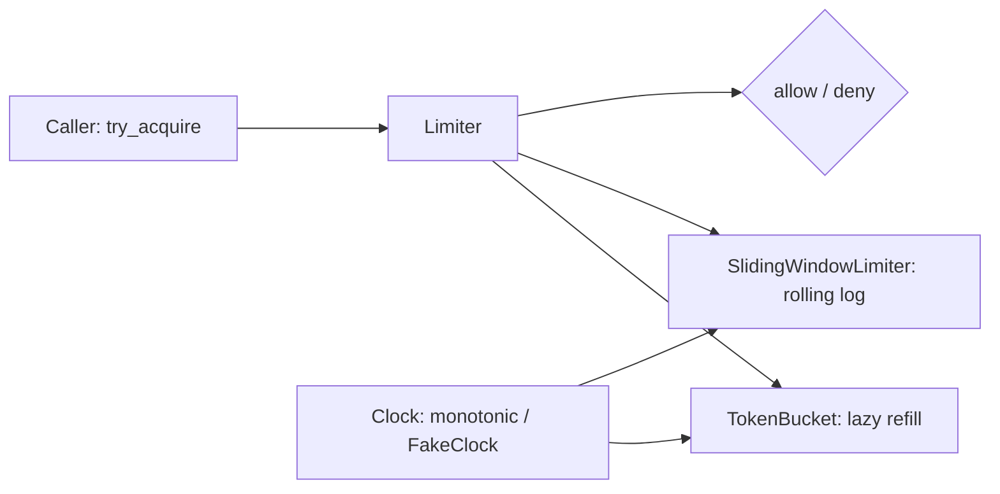

<p align="center">
  
</p>

<h1 align="center">Rate Limiter</h1>

<p align="center">
  <strong>Token-bucket and sliding-window rate limiters with a pluggable clock — in pure Python.</strong><br>
  Inject a clock, hammer a limiter, and get deterministic allow/deny decisions with zero real sleeping.
</p>

<p align="center">
  <em>Built and maintained by <a href="https://viprasol.com">Viprasol Tech</a> — Fintech Experts. Full-Stack Builders.</em>
</p>

<p align="center">
  <a href="https://github.com/Viprasol-Tech/rate-limiter/actions/workflows/ci.yml"></a>
  <a href="LICENSE"></a>
  
  <a href="https://t.me/viprasol_help"></a>
  <a href="https://github.com/Viprasol-Tech/rate-limiter/stargazers"></a>
</p>

---

> **Offline & deterministic by design.** Every limiter takes a `clock: Callable[[], float]`.
> Production code uses `time.monotonic`; tests and the demo inject a `FakeClock` and advance
> time explicitly — so behaviour is exact and reproducible with **no real sleeping, no network,
> no API keys**.

---

## Features

- **Token bucket** — `TokenBucket(capacity, refill_rate)` allows bursts up to `capacity` while bounding the long-run average to `refill_rate` tokens/sec. Lazy, allocation-free refilling.
- **Sliding window** — `SlidingWindowLimiter(max_requests, window_seconds)` keeps an exact rolling count, avoiding the 2x burst a fixed window allows at its boundary.
- **Pluggable clock** — inject any `Callable[[], float]`; `FakeClock` makes tests deterministic with no sleeping.
- **Back-off helpers** — `time_until_available()` tells a caller exactly how long to wait before retrying.
- **CLI demo** — `rate-limiter demo --limiter token` hammers a limiter and prints allowed/denied counts.
- **Modern tooling** — ruff, mypy (strict), pytest, GitHub Actions CI.

## Quickstart

```bash
git clone https://github.com/Viprasol-Tech/rate-limiter.git
cd rate-limiter
python -m pip install -e ".[dev]"

# Hammer a token bucket, then a sliding window:
rate-limiter demo --limiter token
rate-limiter demo --limiter sliding
```

## Use it in code

```python
from rate_limiter import TokenBucket, SlidingWindowLimiter
from rate_limiter.clock import FakeClock

# Deterministic test with an injected clock:
clock = FakeClock()
bucket = TokenBucket(capacity=5, refill_rate=2.0, clock=clock)

for _ in range(5):
    assert bucket.try_acquire() is True   # burst up to capacity
assert bucket.try_acquire() is False      # bucket empty

clock.advance(1.0)                         # 1s -> +2 tokens refilled
assert bucket.try_acquire() is True

# Sliding window: 100 requests per 60s, exact rolling count.
limiter = SlidingWindowLimiter(max_requests=100, window_seconds=60.0)
if limiter.try_acquire():
    handle_request()
else:
    retry_after = limiter.time_until_available()
```

In production, simply omit `clock` and the limiters default to `time.monotonic`.

## Architecture



## Roadmap

- [x] Token-bucket limiter with injectable clock
- [x] Sliding-window (log) limiter with injectable clock
- [x] `time_until_available()` back-off helpers + CLI demo
- [ ] Fixed-window and leaky-bucket variants
- [ ] Async (`anyio`) acquire-and-wait wrappers
- [ ] Pluggable shared backends (Redis) for distributed limiting

## Contributing

PRs welcome — see [CONTRIBUTING.md](CONTRIBUTING.md) and our [Code of Conduct](CODE_OF_CONDUCT.md).

## Contact — Viprasol Tech Private Limited

- Website: [viprasol.com](https://viprasol.com)
- Email: [support@viprasol.com](mailto:support@viprasol.com)
- Telegram: [t.me/viprasol_help](https://t.me/viprasol_help) | WhatsApp: +91 96336 52112
- GitHub: [@Viprasol-Tech](https://github.com/Viprasol-Tech) | [LinkedIn](https://www.linkedin.com/in/viprasol/) | X [@viprasol](https://twitter.com/viprasol)

## License

[MIT](LICENSE) (c) 2025 Viprasol Tech Private Limited
